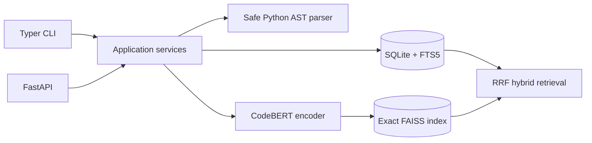

# CodeSearch-FT

CodeSearch-FT is a local Python code search engine. It indexes function definitions without executing repository code and searches by lexical relevance, CodeBERT embeddings, or rank fusion.

## Features

- Python AST indexing with source locations and bounded filesystem traversal.
- SQLite FTS5 BM25 lexical search and exact FAISS inner-product semantic search.
- Shared CodeBERT query/code encoder with attention-mask mean pooling and normalized embeddings.
- Deterministic reciprocal-rank fusion (RRF) for hybrid retrieval.
- Local Typer CLI and localhost-first FastAPI service.
- Explicit contrastive fine-tuning and fixed-pool evaluation pipelines.

## Architecture



The `src/codesearch_ft` package is a modular monolith. Domain contracts are framework-independent; CLI and API compose the same application services. Target repositories are treated as untrusted text and never imported or run.

## Installation

Requires Python 3.11–3.13 and [uv](https://docs.astral.sh/uv/). Install the application and CPU inference dependencies:

```bash
uv sync --locked --extra inference --group dev
uv run codesearch --help
```

Model weights are not fetched on installation. To explicitly cache the pinned CodeBERT weights, run:

```bash
uv run codesearch models download
```

## Quickstart: index and search

```bash
uv run codesearch index ./my-python-project --database ./codesearch.sqlite3
uv run codesearch search "remove duplicates while preserving order" --mode lexical --database ./codesearch.sqlite3
```

Lexical mode needs no model. For semantic or hybrid indexing, first download the model, then create a semantic index:

```bash
uv run codesearch index ./my-python-project --semantic --database ./codesearch.sqlite3
uv run codesearch search "remove duplicates while preserving order" --mode semantic --database ./codesearch.sqlite3 --top-k 10
uv run codesearch search "remove duplicates while preserving order" --mode hybrid --database ./codesearch.sqlite3 --top-k 10
```

`--update` reconciles changed and removed files. The scanner has file-size and file-count limits and skips symlinks. SQLite stores indexed source snippets; protect the database as you would the source tree.

## CLI and API

Useful commands include `codesearch models list`, `codesearch indexes list`, `codesearch config validate CONFIG --kind training`, `codesearch train --config CONFIG`, and `codesearch benchmark --config CONFIG`. Training and benchmark commands start only when invoked explicitly. Run `codesearch serve` to bind the API to `127.0.0.1:8000` by default.

```bash
curl http://127.0.0.1:8000/health
curl http://127.0.0.1:8000/v1/models
curl -X POST http://127.0.0.1:8000/v1/search \
  -H 'Content-Type: application/json' \
  -d '{"query":"preserve first occurrence order","mode":"lexical","top_k":10}'
```

The API exposes health, model/index metadata, and bounded search. It does not expose repository indexing or training over HTTP.

## Fine-tuning and evaluation

The training pipeline uses the pinned Python CodeSearchNet source, preserves official partitions, records dataset manifests and duplicate/leakage checks, and runs the existing PyTorch/Accelerate trainer. Open `notebooks/codesearch_ft_colab_pilot.ipynb` in Google Colab for the bounded GPU pilot workflow. It saves training outputs to Google Drive when the notebook is run.

For evaluation, use `notebooks/codesearch_ft_colab_evaluation.ipynb` and the already fine-tuned checkpoint. It compares BM25, pretrained CodeBERT, fine-tuned CodeBERT, and hybrid retrieval against the same held-out queries and candidate pool. The notebooks have no saved outputs and require explicit user execution.

### Verified benchmark

The recorded run used 124 queries and 128 candidates from the pinned CodeSearchNet Python test split. Relevance labels are automatic documentation-to-function associations, not human judgments.

| Method | MRR@10 | Recall@10 |
|---|---:|---:|
| BM25 | 0.5975 | 0.8763 |
| Pretrained CodeBERT | 0.0340 | 0.1089 |
| Fine-tuned CodeBERT | 0.6724 | 0.9355 |
| Hybrid | 0.7547 | 0.9409 |

These are measurements for this fixed sample only. The query count is limited, source-order sampling may bias selection, relevance is automatic and incomplete, CodeBERT pretraining overlaps CodeSearchNet, and the full 2,000-pair training manifest was not available for independent reintersection with all evaluation examples. Results do not establish generalization to unseen projects. See [`docs/evaluation.md`](docs/evaluation.md) and the compact verified outputs in [`reports/phase5`](reports/phase5).

## Docker

The image is for CPU inference and requires no CUDA device. Build and run it with a local-only port mapping and persistent data volume:

```bash
docker build -t codesearch-ft .
docker run --rm -p 127.0.0.1:8000:8000 -v codesearch-data:/var/lib/codesearch codesearch-ft
```

The API health check is available at `http://127.0.0.1:8000/health`. Index and search commands can also be run in the image with `docker run --rm -v /path/to/repo:/workspace:ro -v codesearch-data:/var/lib/codesearch codesearch-ft codesearch index /workspace`.

## Project layout

- `src/codesearch_ft/` — application package, adapters, CLI, API, training, evaluation.
- `tests/` — deterministic CPU and offline unit/integration tests.
- `configs/` — training and evaluation profiles.
- `notebooks/` — reproducible Colab pilot and evaluation.
- `docs/` — architecture, dependency decisions, training and evaluation notes.
- `reports/phase5/` — compact benchmark metrics, manifests and verification record.
- `.github/workflows/quality.yml` — locked Python 3.11/3.12 quality matrix.

## Quality checks

```bash
uv run ruff check .
uv run ruff format --check .
uv run pyright
uv run pytest
uv build
```

Tests use deterministic local fixtures and do not download model weights or datasets. See [training](docs/training.md) and [evaluation](docs/evaluation.md) for source, reproducibility and limitation details.
